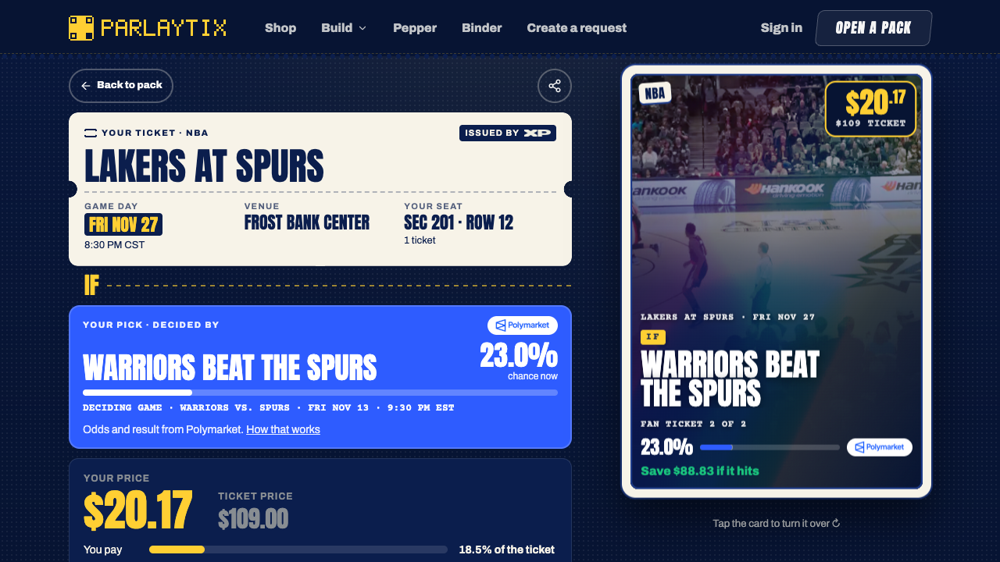

# Pepper for Hermes

Say **“parlay this”** to the Hermes assistant you already use. With a verified ticket, Pepper can show two complementary outcomes for the same seat. Choose the side you want to keep and review listing the other in your wallet. If you need a ticket, Pepper can find an existing offer and show its event, condition, seat and current price. You can resume a saved draft in a new chat.

## Install

Run the install on the host and Hermes profile that serve your chat. Pepper 0.4.0 has been tested on stock Hermes 0.23.0.

```sh
hermes plugins install Akshay-Scalelabs/pepper-hermes-plugin --enable
```

Complete the ParlayTix connection below with your own account. If your channel has an explicit toolset list, include `pepper` and `parlaytix-prod` alongside its existing tools. Reload the gateway that serves the profile after configuration and start a new conversation. Say **“parlay this”**.

**Availability.** Live splitting requires ParlayTix to admit the specific account and verified, unsplit ticket. With an eligible ticket you can preview the outcomes. Without one, choose **“find one”**, name an event and select an offer to see the buyer’s review page. Both issued rights initially belong to the holder. The holder decides whether to list one and signs that action in ParlayTix.



Pepper opened this signed-out ParlayTix page during a buyer-review test. The price in the screenshot was the quote for that run.

## Setup

Pepper uses the native `register_system_prompt_section`, `call_mcp` and persistent-state APIs. Hermes owns the chat, OAuth and tool approvals.

Sign in with your own ParlayTix account through Hermes. The public MCP uses Streamable HTTP and WorkOS OAuth at `https://mcp.parlaytix.xyz/mcp`. Stock Hermes uses its published client metadata and PKCE.

For a fresh profile, run these commands to configure the connection and sign in.

```sh
hermes config set mcp_servers.parlaytix-prod.enabled false
hermes config set mcp_servers.parlaytix-prod.url https://mcp.parlaytix.xyz/mcp
hermes config set mcp_servers.parlaytix-prod.auth oauth
hermes config set mcp_servers.parlaytix-prod.trust untrusted
hermes config set mcp_servers.parlaytix-prod.headers.User-Agent HermesAgent
hermes config set mcp_servers.parlaytix-prod.oauth.user_agent HermesAgent
hermes config set plugins.entries.pepper.mcp_allowlist '["parlaytix-prod"]'
hermes mcp login parlaytix-prod
hermes config set mcp_servers.parlaytix-prod.enabled true
hermes mcp test parlaytix-prod
```

The equivalent non-secret configuration is:

```yaml
mcp_servers:
  parlaytix-prod:
    url: https://mcp.parlaytix.xyz/mcp
    auth: oauth
    trust: untrusted
    headers:
      User-Agent: HermesAgent
    oauth:
      user_agent: HermesAgent
plugins:
  entries:
    pepper:
      mcp_allowlist: [parlaytix-prod]
```

Use Hermes's configuration commands to merge these settings; never replace the whole profile config. Grant only this server. MCP calls without an explicit read-only hint may ask for approval under `untrusted`; preserve those prompts. Unattended calls must not disable approval or use YOLO to get past them.

For a remote VPS, run normal CLI OAuth there, and forward its selected callback port to the local machine before completing browser consent. Native CIMD selects ports 27890–27894. When Hermes runs directly on the VPS host, the tunnel is:

```sh
ssh -N -o ExitOnForwardFailure=yes -L 127.0.0.1:SELECTED_PORT:127.0.0.1:SELECTED_PORT PERSONAL_VPS
```

Replace the placeholders with the observed port and confirmed personal host. Do not set `oauth.redirect_port`, `redirect_uri` or another client's identity to force the callback; these change native CIMD selection. Complete consent through the normal user-owned sign-in. Never paste the callback URL/code or copy token files. Desktop-initiated sign-in and reuse of CLI credentials are separate acceptance checks.

If Hermes runs inside a container, its callback listener binds **the container's loopback interface**. SSH forwarding to the VPS host's loopback, or to the container IP alone, does not reach that listener. Establish an isolated forward into the container network namespace and its loopback listener, then tunnel that host-side forward over SSH. Verify this path before consent; do not expose the callback port publicly or change the unrelated project's container networking.

If the connection has an explicit tool include-list, preserve its entries and add `list_my_ticket_inventory`, `list_my_ticket_assets`, `search_ticket_split_questions`, `preview_ticket_split`, `create_ticket_split` and `get_ticket_split`. These are fixed product tools; do not grant an arbitrary passthrough.

**Scout watches.** A watch asks ParlayTix to look for tickets to one event under a total price. It needs the separate Scout read and Scout write consents, granted under AI agents in ParlayTix; the ticket permissions do not cover it. With an explicit include-list, also add `list_scout_intents`, `get_scout_intent`, `create_scout_intent`, `activate_scout_intent`, `pause_scout_intent`, `resume_scout_intent`, `cancel_scout_intent` and `respond_to_scout_intent_approval`. Pepper saves a draft, activates it only after you confirm, and never pays: a paid step returns a ParlayTix payment page. Pepper sends no notifications, so ask “any news on my watch?” to read its stored state. Editing a watch's terms and funding from your own XP account are not available here.

Start a new Hermes chat after setup or this upgrade so it receives Pepper’s native prompt section. Say **“parlay this”**. Answer the ownership question, choose an eligible ticket and deciding question, then review both outcomes before accepting the split. You do not need to name Pepper or supply internal IDs. When returning, ask “Resume my Pepper parlay.” For the existing buyer flow, ask “Use Pepper to find fan tickets for [event]” and accept the exact selected conditional offer before requesting its wallet review.

If the connection test reports `OAUTH_CLIENT_NOT_ALLOWED` after sign-in, contact ParlayTix about admission for the native Hermes OAuth client. A different client identity would have a different grant.

## Tools

| Tool | Behavior |
| --- | --- |
| `pepper_start` | Start the guided ownership/find-ticket conversation without product calls or state changes |
| `pepper_connection` | Read the current account and granted permissions |
| `pepper_find` | Explicit-query event search and listing candidates, preserving coverage |
| `pepper_select` | Fetch a ticket and save its terms for the verified account/profile |
| `pepper_resume` | Restore the selection, compare fresh terms and read actual checkout status |
| `pepper_forget` | Clear only this account/profile's saved selection |
| `pepper_review` | Recheck the saved terms and prepare the canonical wallet review link |
| `pepper_status` | Read checkout status and matching finalized purchase receipt |
| `pepper_owned` | Read whole-ticket eligibility and existing held rights |
| `pepper_questions` | Discover deciding questions for the owned ticket |
| `pepper_parlay` | Save the exact two-outcome preview without issuing rights |
| `pepper_split` | Refresh accepted terms, save the request key, then submit the explicitly confirmed split |
| `pepper_parlay_status` | Recover/resume the same request and check minted rights and actual listing |
| `pepper_offer` | Save the other right's proposed ask and return its wallet review page |
| `pepper_parlay_forget` | Clear a preview or completed local draft without cancelling product state |
| `pepper_watches` | Read your Scout watches, or one watch with its pending approval |
| `pepper_watch` | Save a draft watch for one event: tickets, total cap, deadline and approval mode |
| `pepper_watch_control` | Activate, pause, resume or cancel a watch after explicit confirmation |
| `pepper_watch_respond` | Approve or decline a watch's pending approval after the user decides |

The plugin uses documented `ctx.call_mcp`, so Hermes owns OAuth, credentials, refresh, transport and approvals. It makes requests only to the configured `parlaytix-prod` server and does not expose an arbitrary tool passthrough. It reads no credential files, runs no shell commands, starts no background work, and sends no telemetry. Responses are treated as untrusted data. Confirmed holder splitting creates real rights through the existing issuer. Preview, status and listing-review preparation do not sign or spend from the customer's wallet.

The account-bound Parlay record stores one current draft: exact ticket/source identities, outcome rules, preview hashes, chosen keep outcome, stable request key, split ID and proposed offer. It contains no credentials or wallet signing payload. A lost write response keeps that request key for read-only recovery. An explicit listing review opens the existing card page: the user enters the price there and reviews fees before signing. Pepper verifies the resulting listing against the saved ask; it does not equate a listing with a sale.

`ctx.state` stores one selected ticket per ParlayTix account under the active Hermes profile's plugin-data directory. Stored data includes the account ID, generated selection ID, selected/read timestamps and a bounded projection of the ticket, condition, listing, deadlines and market observation. It excludes credentials, raw wallet payloads and checkout receipts. Hermes writes this JSON atomically with mode `0600`. These local records are not encrypted by Pepper; the profile's owner can read them. Pepper checks live account identity and ticket permissions before restoring a record and rechecks identity after the product reads. Revoked access cannot fall back to an offline saved card. Local selection state is not authoritative proof of price, inventory, a running watch or ownership.

`pepper_forget` clears the current account's record after a successful identity check. Other accounts/profiles keep their own selections. Uninstalling a package does not necessarily delete Hermes's plugin-data directory; manage retained plugin data separately if the account can no longer sign in. Resuming never requests a new checkout, changes the saved accepted terms or automatically retries an unknown response.

Explicit stock-Hermes approval denial and reauthentication responses retain their stop instructions through bounded error categories. Unknown responses never authorize automatic retries: inspect product status and connection state first. Raw upstream errors are not returned.

## Verification

Try these cases from your own Hermes chat.

| Try | Expected result |
| --- | --- |
| Say “parlay this” in a new chat. | Pepper asks whether you have a ticket or want to find one. The opening makes no product call. |
| Choose “I have a ticket” with an empty or ineligible inventory. | Pepper explains what your account holds. It cannot create a split from an event name. |
| Preview an eligible ticket, then open a new chat and say “resume my Pepper parlay.” | The same account sees its draft and refreshed terms. Another account cannot resume it. |
| Decline a native tool approval. | Pepper stops. A new attempt requires a new direction from you. |
| Choose “find one,” select an offer and open wallet review. | The Terminal page shows the selected terms. Opening review does not complete a purchase. |
| Choose “find one,” then ask Pepper to watch for two tickets under a total price. | Pepper saves a draft watch, shows its terms and activates it only after you confirm. Without Scout consent it says so and makes no watch. |
| With a separately admitted ticket, keep one outcome and review the other at your chosen price. | Pepper asks for exact split confirmation. Terminal asks for the listing signature. Pepper reports a listing only after it reads an active listing for the correct right and ask. |

The automated suite also exercises changed terms and recovery after a lost issuer response. Run it from a checkout with the stock Hermes Python environment to include the two native host tests.

```sh
python3 -m unittest discover -s tests -v
hermes plugins doctor /absolute/path/to/pepper-hermes-plugin --ci
hermes plugins validate /absolute/path/to/pepper-hermes-plugin --install-deps
```

The tests exercise tool registration, refusal and truncation, account and profile separation, changed terms, durable recovery, review links and receipt checks. The issuer and wallet responses in these tests are fixtures. Live operations require the signed-in account’s permissions and confirmations.

To uninstall, run `hermes plugins disable pepper` and `hermes plugins remove pepper`. Remove the MCP connection with `hermes mcp remove parlaytix-prod` if this profile used it only for Pepper. You can revoke the ParlayTix account grant separately.
